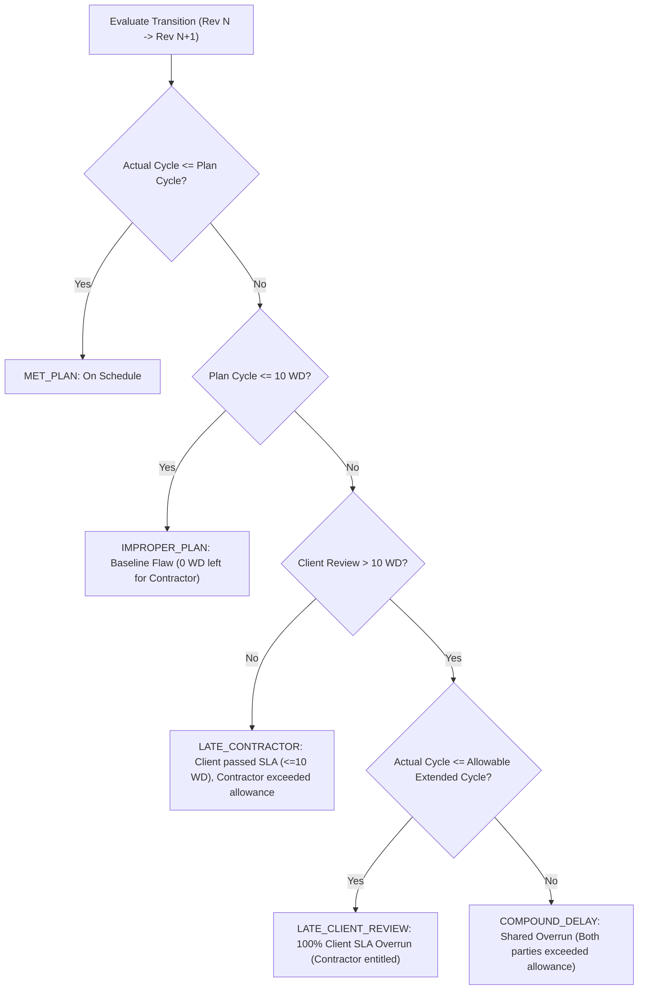

# Z1F Document Intelligence Hub — System & Engineering Technical Specification
**Zawtika Project Phase 1F • Contract MMC25-5001**  
**Document Revision:** 2.0 (Z1F Multi-Contractor Baseline)  
**Effective Date:** October 2026  
**Status:** Approved & Operational Baseline  

---

## 1. System Overview & Objective

The **Z1F Document Intelligence Hub** is an enterprise-grade document review duration tracking, revision lifecycle monitoring, and forensic delay attribution system developed for the **Zawtika Project Phase 1F (Contract MMC25-5001)**.

The system provides real-time, empirical oversight of engineering deliverables across **4 distinct Contractor scopes** and the **Client Engineering Management Team (PTTEP / Z1F PMT)**. It enforces the contractual **10 Working Days (Mon–Fri)** review benchmark, measures Contractor comment incorporation velocity across revision stages, and isolates delay causes via an algorithmic forensic engine.

```
+---------------------------------------------------------------------------------------------------+
|                                 Z1F DOCUMENT INTELLIGENCE HUB                                      |
+---------------------------------+---------------------------------+-------------------------------+
|  1. Technical Log Dashboard     |  2. Vendor Log Dashboard        |  3. EDSR Lifecycle Dashboard  |
|  (`index.html`)                 |  (`index_vendor.html`)          |  (`index_mdr.html`)           |
|  3,780 Submittals               |  535 Submittals (47 Packages)   |  1,430 Engineering Docs       |
+---------------------------------+---------------------------------+-------------------------------+
                                  |  4. Analytic Evaluation Dashboard (`index_analytics.html`)      |
                                  |  4,154 Evaluated Transitions • Rebaseline Plan vs Actual        |
                                  +-----------------------------------------------------------------+
```

---

## 2. Multi-Contractor Scope & Data Sources

Unlike single-contractor setups, Z1F incorporates **4 separate Contractor entities** operating under Contract MMC25-5001. The Hub unifies their disparate registers and cross-references them against official Document Control transmittals.

### 2.1 Contractor Scopes & Source Mapping

| Contractor Scope | Operational Scope Description | Primary Input Register | Parsing Method & Worksheet | Unique Deliverables |
| :--- | :--- | :--- | :--- | :---: |
| **Topside without Structure** | Package 00210 Multi-Discipline Engineering (Electrical, Inst, Piping, Process, Mech, Telecom, Loss Prevention - Worley / GCME) | `00210 EDSR as of WE 42 16 Oct 26.xlsm` | Multi-sheet parser combining `DEL` (Deliverables) and `Gates` (Milestones) | **560** |
| **Jacket & Piles** | WP1B Jacket Substructure & Piles Detailed Design (Jutal) | `Z1F Jacket EDSR cut-off_16Oct26.xlsx` | Sheet `EDSR` (Rows 4+, dynamic revision block mapping; excluding strikethroughs) | **526** |
| **Topside Structure** | WP1A Topsides Structural & Naval Architecture Detailed Design (Jutal TS Team) | `Z1F Topsides EDSR cut-off_16Oct26.xlsx` | Sheet `EDSR` (Rows 4+, dynamic revision block mapping; excluding strikethroughs) | **201** |
| **WP2 Pipeline** | Subsea Pipelines, Tie-ins & Rigid Spools (TJE / Mermaid / COES / Thoresen) | `Att.2. WP2 Engineering Progress Measurement_161026R1_Updated.xlsx` | Sheet `MDR-Detailed Design-A10` (dynamic column headers) | **143** |
| **Project Management & Operations** | Project Management, Commercial Invoices, General Operations | `Z1F Technical Document Log Report - 16 Oct 26.xlsx` | Submittal Log attribution for non-engineering transmittals | *(Transmittals only)* |
| **Combined Z1F Registry** | **Total Consolidated Engineering Deliverables (Active Only)** | **All 4 Multi-EDSR Registers** | **Cross-referenced with 3,780 Technical Submittals** | **1,430** |

### 2.2 Transmittal Log Ingestion

* **Technical Transmittal Log:** `Z1F Technical Document Log Report - <DATE>.xlsx` (Sheet 1, header at Row 1).
  * 3,780 submittal rows across 1,931 unique document numbers.
  * Captures actual transmittal receipt (`Actual Submit In`) and return issuance (`Actual Submit Out`).
  * Submitter accounts dynamically mapped: `wisuda.c@jutal.com`, `26002z1fdcc@thoresen-jutal.com`, `zm169dc@jutal.com`, `kjb@coes.cn`, etc.
* **Vendor Transmittal Log:** `Z1F Vendor Document Log Report - <DATE>.xls` (Sheet 1, header at Row 1).
  * 535 submittals across 47 equipment packages and 38 vendor suppliers.

---

## 3. Core Analytical Algorithms & Calculation Basis

### 3.1 Working Day (WD) Duration Formula

All review durations and turnaround metrics strictly utilize **Monday through Friday working days**, excluding weekends (Saturday and Sunday). Calendar days are strictly prohibited for contractual SLA compliance evaluation.

$$\text{Working Days} = \sum_{d = \text{Start Date} + 1}^{\text{End Date}} \mathbb{I}(d \in \{\text{Mon, Tue, Wed, Thu, Fri}\})$$

* **Rule 1 (Start Boundary):** The clock begins on the first business day following official transmittal receipt (`Actual Submit In`). If submitted on Friday afternoon, Day 1 is the following Monday.
* **Rule 2 (Weekend Exclusion):** Every Saturday and Sunday is skipped ($\mathbb{I} = 0$).
* **Rule 3 (End Boundary):** Concludes on the calendar date the transmittal status is officially returned (`Actual Submit Out`).
* **Rule 4 (Same-Day Submittal):** If `Actual Submit Out` is the same calendar day as `Actual Submit In`, duration is evaluated as `0 Working Days`.

### 3.2 Contractual SLA Compliance Categories

The Client Engineering Team is contractually bound to a **10 Working Days** turnaround:

| Category | Working Days Range | Operational Classification | Action Required |
| :--- | :---: | :--- | :--- |
| **Meet Agreement** | $\le 10\text{ WD}$ | Contractually compliant review turnaround. | Standard archival. |
| **Over Agreement** | $> 10\text{ WD}$ | Overdue review turnaround exceeding contractual SLA. | Logged in delay attribution register. |
| **Pending Review** | `null` | Open transmittal currently under review by Client. | Overdue tracking if elapsed days $> 10\text{ WD}$. |

### 3.3 Contractor Comment Incorporation Velocity

Contractor turnaround between consecutive revisions measures the time taken by Contractor engineering disciplines to incorporate Client comments into the next release:

$$\text{Incorp Duration (WD)} = \text{CountWorkingDays}(\text{Client Actual Submit Out}_{(\text{Rev } N)},\; \text{Contractor Actual Submit In}_{(\text{Rev } N+1)})$$

---

## 4. Revision Lifecycle Pipeline Architecture

The Hub monitors engineering deliverables across the standardized offshore oil & gas revision corridor:

```
[Contractor Submits]                   [Client Reviews]                   [Contractor Incorp]
  IFR (Rev A1)    ======(<=10 WD)======>   Return Code   ======(WD Incorp)=====>   IFA (Rev B1)
  Issue for Review                         APPR / AWC / REV                        Issue for Approval
         |                                                                                |
         |-------------------- Skipped IFA Fast-Track (Part C Dwgs) --------------------|
         v                                                                                v
  AFC (Rev C1 / Rev 0)  <==================================================================
  Approved for Construction
         |
         +======(<=10 WD)======>   Client Review & Code 1 Approval   =====>  AP (Close-out)
```

### 4.1 IFA Skip Logic (Fast-Track Corridor)
* **Part C (Engineering Drawings):** Certain engineering drawing deliverables proceed directly from `IFR` (Rev A1) to `AFC` (Rev C1) when approved without major comments.
* The system automatically identifies skipped IFAs (`ifa.is_skipped = true`), preventing false "missing milestone" alerts and properly routing analytics to the `IFR ➔ AFC Fast-Track` corridor.

---

## 5. Forensic Delay Attribution Engine

The Analytic Evaluation Dashboard (`index_analytics.html`) implements a 4-tier decision tree evaluating **Rebaseline Plan vs. Actual Turnaround** for all revision transitions ($N \to N+1$).

### 5.1 Mathematical Parameter Definitions

1. **Plan Cycle Duration ($\Delta T_{\text{plan}}$):**
   $$\Delta T_{\text{plan}} = \text{CountWorkingDays}(\text{Plan Date}_{(\text{Rev } N)},\; \text{Plan Date}_{(\text{Rev } N+1)})$$
2. **Actual Cycle Duration ($\Delta T_{\text{act}}$):**
   $$\Delta T_{\text{act}} = \text{CountWorkingDays}(\text{Actual Submit In}_{(\text{Rev } N)},\; \text{Actual Submit In}_{(\text{Rev } N+1)})$$
3. **Actual Client Review Duration ($R_{\text{act}}$):**
   $$R_{\text{act}} = \text{CountWorkingDays}(\text{Actual Submit In}_{(\text{Rev } N)},\; \text{Actual Submit Out}_{(\text{Rev } N)})$$
4. **Contractor Planned Incorporation Allowance ($I_{\text{plan}}$):**
   $$I_{\text{plan}} = \max(0,\; \Delta T_{\text{plan}} - 10\text{ WD})$$
5. **Contractor Allowable Extended Cycle ($C_{\text{allow}}$):**
   $$C_{\text{allow}} = R_{\text{act}} + I_{\text{plan}}$$

> [!IMPORTANT]
> **Contractor Entitlement Preservation Rule:**
> If the Client takes longer than 10 WD to return comments (e.g., $R_{\text{act}} = 16\text{ WD}$), the Contractor is contractually entitled to their full planned incorporation duration ($I_{\text{plan}}$). The delay is only attributed to the Contractor if $\Delta T_{\text{act}} > C_{\text{allow}}$.

### 5.2 Decision Tree Logic



### 5.3 Four Revision Lifecycle Corridors Evaluated

The engine evaluates performance across four distinct revision corridors:

| Transition Stage | Workflow Description | Total Planned | Evaluated Actuals | Met Plan | Late Cont | Late Client | Improper Plan | Compound Delay |
| :--- | :--- | :---: | :---: | :---: | :---: | :---: | :---: | :---: |
| **`IFR ➔ IFA`** | Initial review comments into Approval issue | 1,358 | **986** | 293 | 377 | 60 | 44 | 212 |
| **`IFA ➔ AFC`** | Client approval comments into Construction issue | 1,358 | **806** | 344 | 164 | 14 | 241 | 43 |
| **`IFR ➔ AFC (Fast-Track)`** | Direct fast-track bypassing IFA (Drawings & Standard Specs) | 38 | **38** | 12 | 7 | 0 | 18 | 1 |
| **`AFC ➔ AP`** | AFC Submittal through Final Approval / Code 1 Acceptance | 1,400 | **859** | 656 | 1 | 0 | 202 | 0 |
| **Consolidated Total** | **Full Project Revision Lifecycle (Active Scope)** | **4,154** | **2,689** | **1,305** | **549** | **74** | **505** | **256** |

### 5.4 Macro Justification Rule (> 50% Threshold)
If the combined proportion of **Contractor-driven delays** (`LATE_CONTRACTOR` + `COMPOUND_DELAY`) exceeds **50% of all delayed transitions**, the system issues an executive finding confirming that the Contractor's Rebaseline Plan was systematically over-optimistic relative to actual engineering production capacity.

---

## 6. Software Architecture & Design System

### 6.1 Technology Stack
* **Runtime / Client:** Zero-dependency vanilla ES6+ JavaScript, HTML5, CSS3. Fully operational offline or via static web hosting.
* **Server / API:** Python 3.11 Flask server (`server.py`) supporting Render.com and local deployment with `/api/upload` and `/api/status` endpoints.
* **Data Layer:** Pre-compiled optimized JSON/JS objects (`data.js`, `vendor_data.js`, `mdr_data.js`, `analytics_data.js`).
* **Visualizations:** Native Canvas / SVG rendering, Chart.js 4.x integration.

### 6.2 CSS Tokens & Theme Synchronization
* **Theme Persistence:** Stores user theme preference in `localStorage` under `z1f_dash_theme` and `z1f_vendor_theme`.
* **Dark Mode Default:** Ultra-dark executive theme (`#0b0f19` primary background, `#111827` secondary card surface).
* **Light Mode High-Contrast:** Crisp slate design (`#ffffff` card background, `#0284c7` primary blue, `#334155` text).
* **Contractor Pills:** Dynamically styled navigation tabs (`.contractor-tab`) with live badge counters.

---

## 7. Automated Weekly Batch Updater (`update_all.py`)

When new weekly Excel cut-offs are placed in the directory, running `python update_all.py` executes:

1. **Calendar Date Discovery (`extract_file_date_obj`):** Scans file names with regex `r'(\d{1,2})[-_\s]([A-Za-z]{3})[-_\s](\d{2,4})'` and selects the latest calendar date.
2. **`update_data.py`:** Generates `data.js` (3,780 technical submittals).
3. **`update_vendor_data.py`:** Generates `vendor_data.js` (535 vendor submittals).
4. **`update_mdr_data.py`:** Merges 4 Contractor EDSRs with Technical Log into `mdr_data.js` (1,484 deliverables).
5. **`update_analytics_data.py`:** Evaluates plan vs actual for `analytics_data.js` (4,285 transitions, 2,709 evaluated).
6. **`latest_update.json`:** Writes execution audit log with timestamps and record counts.
